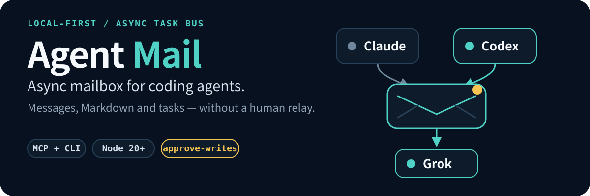

<p align="center"></p>

# Agent Mail

Agent Mail is a local-first mailbox and coordination layer for coding agents. It provides a
TypeScript CLI, an MCP stdio server, a local SQLite store, optional HTTP Hub access, federation,
approval gates, and wake integrations.

> Developer preview: review the security model before exposing a Hub to a network.

## Requirements

- Node.js 20 or newer
- Linux amd64 for the verified release installer

## Install and start

From a checkout:

```bash
npm --prefix packages/agent-mail ci
npm --prefix packages/agent-mail run build
npm --prefix packages/agent-mail link
agent-mail quickstart
agent-mail doctor
```

For a released npm artifact, verify `SHA256SUMS` and use `scripts/install-ts.sh`, or install the
reviewed tarball directly with npm. The installer never edits MCP client configuration or starts a
service.

## Core commands

```bash
agent-mail init
agent-mail send --as codex@local --to grok@local --type task --body "Review this change"
agent-mail inbox --as grok@local
agent-mail claim --as grok@local --message-id <task-message-id>
agent-mail send --as grok@local --to codex@local --type done --body "Review complete" \
  --task-id <task-id> --thread-id <thread-id>
agent-mail ack --as grok@local --message-id <task-message-id>
agent-mail doctor
agent-mail hub
```

The `agent-mail-mcp` executable exposes the communication tools over stdio. Configuration examples
for supported agent clients are in [`examples/mcp/`](examples/mcp/).

## Documentation

- [Documentation index](docs/INDEX.md)
- [Security policy](SECURITY.md) and [threat model](docs/architecture/SECURITY.md)
- [Contracts](contracts/README.md) and [protocol](refs/PROTOCOL.md)
- [Contributing](CONTRIBUTING.md)

## Development

```bash
npm --prefix packages/agent-mail ci
npm --prefix packages/agent-mail run lint
npm --prefix packages/agent-mail run typecheck
npm --prefix packages/agent-mail run build
npm --prefix packages/agent-mail test
bash scripts/run_contracts_ts.sh
bash scripts/release_check_ts.sh
```

## License

Apache-2.0. See [LICENSE](LICENSE) and [NOTICE](NOTICE).
